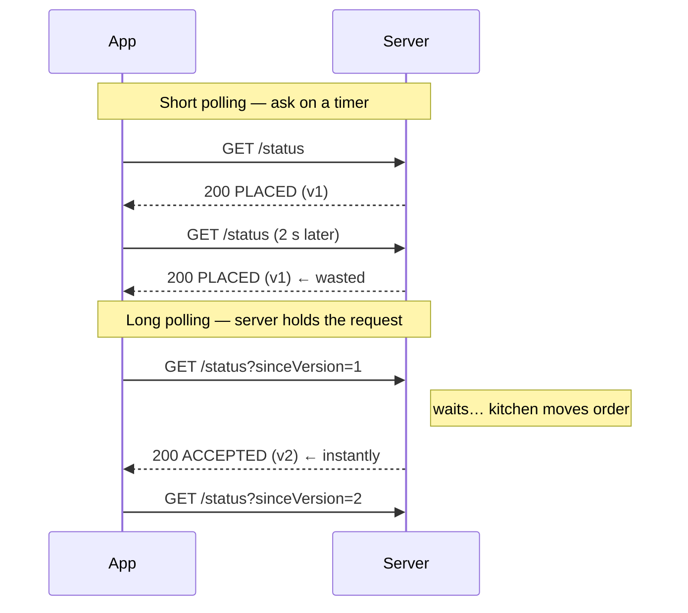

# Exercise 02 — Short Polling vs Long Polling

**Time:** ~45 min  **Port:** 8082  **You'll learn:** why "just call the API every 2 seconds" is wasteful *and* slow, and how long polling fixes both

## The story
After placing an order, the QuickBite app shows a live tracker:
`PLACED → ACCEPTED → PREPARING → OUT_FOR_DELIVERY → DELIVERED`.
The server's "kitchen" moves each order forward on its own every ~3 s (randomised). How does the app find out?



## Run it
```bash
java TrackingServer.java     # terminal 1
java Check.java              # terminal 2 — checks TODO 1
```

## TODOs
| # | File | What |
|---|---|---|
| 1 | `TrackingServer.java` → `longPoll` | Park the request on a `Condition` until `version > sinceVersion` or timeout → 200 / **204** |
| 2 | `PollingClient.java` → `shortPoll` | Loop + sleep, count wasted calls |
| 3 | `PollingClient.java` → `longPoll` | Loop with **no sleep**, re-ask on 204 |

## The experiment (the whole point of this exercise)
Run each and fill the table from the scorecard:
```bash
java PollingClient.java short 500
java PollingClient.java short 2000
java PollingClient.java short 5000
java PollingClient.java long
```
| Mode | HTTP requests | Wasted | Avg notice delay | Missed steps |
|---|---|---|---|---|
| short 500 ms | | | | |
| short 2000 ms | | | | |
| short 5000 ms | | | | |
| long | | | | |

Run `short 5000` a few times — you'll see `!! skipped` lines. The app **never showed** some statuses.

## Think & answer
1. Short polling has one knob (interval). What do you trade when you turn it down? When you turn it up?
2. 1 million users each polling every 2 s — how many requests/second hit your servers, and how many are wasted?
3. Long polling holds a request open for up to 30 s. Why did we use **virtual threads**? What breaks with a fixed pool of 8 threads and 9 waiting users?
4. Why `signalAll()` and not `signal()`? (The checker has a test for this.)
5. Why does the client send `sinceVersion` instead of the server remembering "what this client last saw"?
6. Load balancers and proxies often kill idle connections after ~60 s. How does the timeout + 204 design survive that?
7. When is plain short polling still the **right** choice? (Hint: a report that takes 10 minutes to generate.)

## Stretch
- Start 200 long-poll clients in parallel (a loop with `CompletableFuture`) and watch the server's thread count in `jconsole`. Then switch the executor to `Executors.newFixedThreadPool(8)` and repeat.
- Add **exponential backoff** to the short-poll client when the server returns 503.
