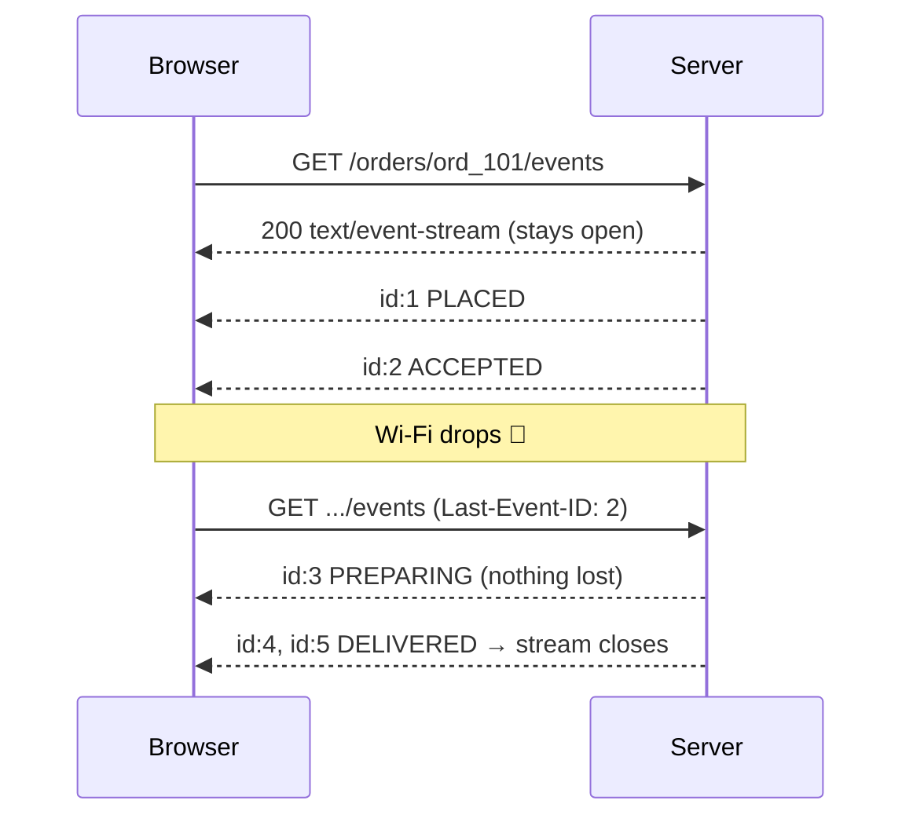

# Exercise 03 — Server-Sent Events (SSE)

**Time:** ~40 min  **Port:** 8083  **You'll learn:** one-way server push over plain HTTP, the SSE wire format, resuming after a disconnect

## The story
Long polling worked, but every update still costs a brand-new request. What if the server just kept **one** response open and wrote to it whenever something happened?

That's SSE. It is literally a response with `Content-Type: text/event-stream` that never ends:
```
id: 1
event: status
data: {"status":"PLACED","version":1}

id: 2
event: status
data: {"status":"ACCEPTED","version":2}

```
Each event ends with a blank line. That's the entire protocol.



## Run it
```bash
java SseServer.java        # terminal 1
java Check.java            # terminal 2
curl -N localhost:8083/orders/ord_101/events   # -N = don't buffer; watch raw events appear
```
Then open **http://localhost:8083** → *Place order* → *Simulate network drop* while it's cooking.

## TODOs in `SseServer.java`
| # | Method | What |
|---|---|---|
| 1 | `writeEvent` | Format `id/event/data` + blank line, and **flush** |
| 2 | `stream` | Headers, replay from `Last-Event-ID`, wait for changes, keep-alive comments, close at the end, **204** when nothing is left |

## Think & answer
1. SSE vs long polling: count the HTTP requests for one order in each. What's the same, what's better?
2. Why does the server need to keep a **history** to support `Last-Event-ID`? What would you use instead of an in-memory list in production? (Hint: Redis Streams, Kafka)
3. Why send `: keep-alive` comments? Who is closing "idle" connections?
4. SSE is server → client only. How does the client send something back? Is that a problem for an order tracker? For a chat?
5. Browsers allow only ~6 HTTP/1.1 connections per domain. What happens with 7 open tabs of the tracker? How does HTTP/2 change that?
6. Name two real products that could use SSE instead of WebSockets. (ChatGPT-style token streaming is one — why does it fit?)

## Stretch
- Add a second event type `eta` (`event: eta`, `data: {"minutes": 12}`) sent every 2 s while `OUT_FOR_DELIVERY`, and show it on the page with `es.addEventListener('eta', ...)`.
- Send `retry: 10000` once at the start of the stream and watch the browser's reconnect delay change.
