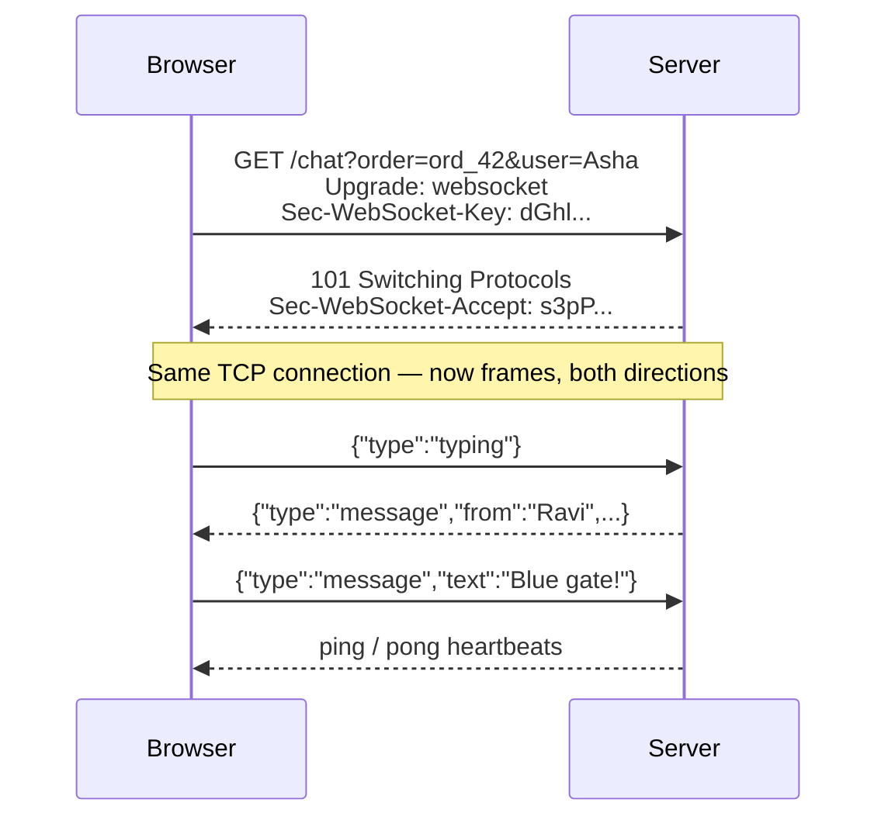

# Exercise 04 — WebSockets (built from raw sockets)

**Time:** ~60 min  **Port:** 8084  **You'll learn:** the HTTP upgrade handshake, frames, full-duplex messaging, rooms & broadcast

## The story
The rider can't find the customer's gate. They need to **chat** — both sides sending at any moment, with "typing…" indicators. SSE is one-way; polling is too slow. Time for a WebSocket.

We build the server on a plain `ServerSocket` (no Spring, no Netty) so you can see there's no magic:



## Run it
```bash
java ChatServer.java                 # terminal 1
java Check.java                      # terminal 2
```
Then: open **http://localhost:8084** in two tabs, join the same order, chat. Also try the terminal client:
```bash
java ChatClient.java ord_42 Ravi
```
Open browser DevTools → Network → click the `chat` request → **Messages** tab. You'll see every frame.

## TODOs
| # | Where | What |
|---|---|---|
| 1 | `ChatServer.acceptKey` | `Base64(SHA-1(key + GUID))` — the whole handshake "proof" |
| 2 | `ChatServer.onOpen` | Join the room, broadcast "joined" + online list |
| 3 | `ChatServer.onMessage` | Route `message` (to all) and `typing` (to all but sender) |
| 4 | `ChatServer.onClose` | Leave the room, broadcast "left" |
| 5 | `ChatClient.main` | Connect with the JDK's `WebSocket` client and send lines |

Read `Ws.readFrame` / `Ws.writeFrame` too — 40 lines that *are* the WebSocket protocol.

## Think & answer
1. Why does WebSocket start as HTTP at all? (Think: port 443, firewalls, proxies, existing load balancers.)
2. Why must browser→server frames be **masked**? (Search: "cache poisoning" attack on proxies.)
3. Our `ROOMS` map lives in one JVM. With 3 server instances behind a load balancer, Asha lands on server A and Ravi on server B. What breaks? How do Redis Pub/Sub or Kafka fix it? What are "sticky sessions"?
4. The server holds one open TCP connection per user. Roughly how many can one box hold, and what limits it (memory, file descriptors, threads)?
5. Ping/pong: who should send pings, and what happens to the room if a phone goes into a tunnel and never sends a Close frame?
6. Chat over WebSocket vs chat over "POST to send + SSE to receive". When is the second one actually better?

## Stretch
- **Heartbeat:** every 20 s, send a PING to each client; if no PONG within 10 s, close it and run `onClose`.
- **History:** keep the last 20 messages per room and replay them to whoever joins.
- **Reconnect:** make the browser page reconnect with exponential backoff (1 s, 2 s, 4 s… max 30 s) when the server restarts.
