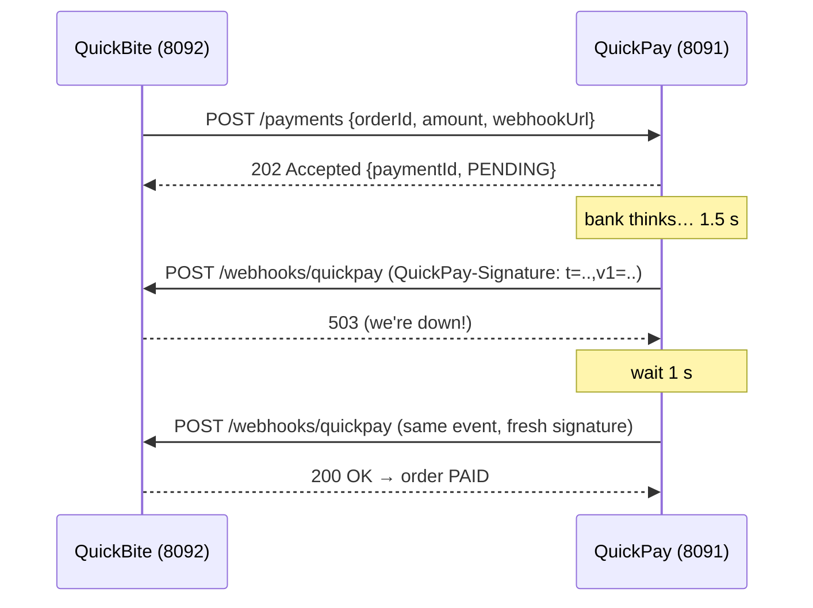

# Exercise 05 — Webhooks (sending *and* receiving)

**Time:** ~60 min  **Ports:** 8091 (gateway), 8092 (merchant)  **You'll learn:** server-to-server callbacks, HMAC signatures, replay protection, retries with backoff, at-least-once delivery & idempotent receivers

## The story
QuickBite charges customers through **QuickPay** (a pretend Razorpay/Stripe). Charging a card takes time, so QuickPay answers `202 Accepted` immediately and **calls QuickBite back** when the bank decides.

That callback is a webhook: *"don't call us, we'll call you."* It's just an HTTP POST — but from the *server* to *your* server. Which means: anyone on the internet can also POST to your webhook URL.



## Run it
```bash
java PayGateway.java      # terminal 1
java MerchantApp.java     # terminal 2
java Check.java           # terminal 3
curl -s -X POST localhost:8092/orders -d '{"amount":499}'   # then GET the order a couple of times
curl -s localhost:8091/deliveries                            # every delivery attempt
```

## TODOs
| # | File | What |
|---|---|---|
| 1 | `PayGateway.signatureHeader` | `t=<ts>,v1=HMAC_SHA256(secret, "<ts>.<body>")` |
| 2 | `PayGateway.deliverWithRetries` | POST, and on failure retry after 1 s, 2 s, 4 s, 8 s |
| 3 | `MerchantApp.receiveWebhook` | Verify signature (constant-time) + reject stale timestamps → **401** |
| 4 | `MerchantApp.receiveWebhook` | Ignore duplicate event ids — but still answer **200** |
| 5 | `MerchantApp.receiveWebhook` | Update the order, respond fast |

## Break it on purpose
Restart in chaos mode and read both logs side by side:
```bash
java PayGateway.java --duplicate     # every event is delivered twice
java MerchantApp.java --flaky        # first 2 webhooks get 503
```
Then check `curl localhost:8092/stats` and `curl localhost:8091/deliveries`.

## Think & answer
1. Webhook vs the merchant **polling** `GET /payments/{id}`. Why do gateways offer both? When do you need the poll anyway? (Hint: what if *all 5* retries fail during your deploy?)
2. Why HMAC and not just a secret token in a header like `X-Secret: abc`? What does HMAC prove that a token doesn't?
3. Why is the **timestamp** inside the signed message? What attack does `TOLERANCE_SECONDS` stop?
4. Why `MessageDigest.isEqual` instead of `String.equals`? (Search: timing attack.)
5. Why must you verify against the **raw body bytes**, not re-serialized JSON?
6. On a duplicate, why answer **200** and not 409?
7. Your handler takes 8 s because it also sends a confirmation email. What goes wrong with the gateway's 5 s timeout? How do you fix it? (Hint: queue.)
8. `payment.failed` arrives *after* `payment.succeeded` for the same order (retries reorder things). What should happen? How would you guard against it?

## Stretch
- Add **jitter** to the backoff (`delay * random(0.5..1.5)`) and explain the "thundering herd" it prevents.
- Persist `PROCESSED_EVENTS` so restarts don't forget them — and expire entries after 7 days.
- Add a reconciliation job to the merchant: every 30 s, `GET /payments/{id}` for orders stuck in `PENDING_PAYMENT` for > 1 min.
