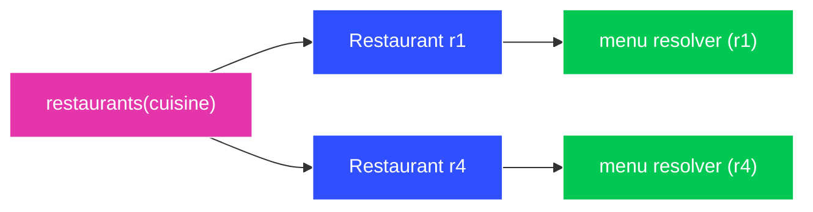

# Exercise 06 — GraphQL

**Time:** ~60 min  **Port:** 8086  **Needs:** Maven  **You'll learn:** schema-first APIs, queries/mutations/variables, field resolvers, over/under-fetching, the N+1 problem

## The story
The QuickBite **home screen** shows South Indian restaurants with their name, rating and two veg dishes with prices.
With the REST API:
```bash
curl -s localhost:8086/rest/restaurants | wc -c          # every field of every restaurant…
curl -s localhost:8086/rest/restaurants/r1/menu           # …then one call PER restaurant for menus
```
That's **over-fetching** (fields you don't need) *and* **under-fetching** (1 + N round trips). On a 3G phone in a lift, that hurts.

GraphQL flips it: **one endpoint**, and the *client* says exactly what shape it wants:
```graphql
query Home {
  restaurants(cuisine: "South Indian") {
    name
    rating
    menu(vegOnly: true) { name price }
  }
}
```


Each field can have its own resolver, which runs **only if the query asks for that field**.

## Run it
```bash
mvn -q compile exec:java          # first run downloads dependencies
```
Open **http://localhost:8086** — a mini playground with sample queries. Or use curl:
```bash
curl -s localhost:8086/graphql -H 'Content-Type: application/json' \
  -d '{"query":"{ restaurants { name cuisine } }"}'
```
Watch the server log: it prints how many times the menu "table" was queried per request.

## TODOs in `src/main/java/lab/GraphQLServer.java`
| # | Resolver | What |
|---|---|---|
| 1 | `Query.restaurants(cuisine)` | Filter by argument |
| 2 | `Query.restaurant(id)` | Return `null` when missing (nullable in schema) |
| 3 | `Restaurant.menu(vegOnly)` | A **field** resolver: uses `env.getSource()` (the parent) |
| 4 | `Mutation.addReview(input)` | Validate, write, return the new object |

`reviews` is already done — copy its pattern for TODO 3.

## Write these queries (in the playground)
1. Names and delivery times of **all** restaurants — nothing else.
2. Restaurant `r2` with its full menu, using a **variable** `$id` instead of hard-coding it.
3. The home-screen query above. How many bytes vs the REST calls? How many requests?
4. Use **aliases** to fetch `r1` and `r4` side by side in one query: `dosa: restaurant(id:"r1") {…} idli: restaurant(id:"r4") {…}`.
5. Define a **fragment** `CardFields on Restaurant { name rating deliveryMinutes }` and use it in two places.
6. Add a review with rating **7**. What HTTP status do you get? Where is the error?
7. Ask for a field that doesn't exist (`restaurants { owner }`). What happens, and *when* — before or after resolvers run?
8. Run the **Introspection** sample. How could a tool use this?

## Think & answer
1. Run query 3 and read the log: `menu table queried N times`. That's the **N+1 problem**. With 1000 restaurants on screen, what happens to the DB? How does a **DataLoader** fix it (batch all `restaurantId`s into one `WHERE restaurant_id IN (...)`)?
2. GraphQL returns HTTP **200** even when a resolver failed. Why? What does that mean for your monitoring/alerting that only looks at status codes?
3. REST GETs are cached by browsers and CDNs using the URL. Every GraphQL query is a POST to `/graphql`. How do teams cache GraphQL? (Search: persisted queries, APQ.)
4. A malicious client sends a query nested 50 levels deep. How do you protect the server? (Depth limits, complexity scoring, timeouts.)
5. Which would you choose for: a public API for third-party developers, an internal BFF for your own mobile app, service-to-service calls? Why?

## Stretch
- Add a `DataLoader` for `menu` (graphql-java ships `org.dataloader`) and make the log say `menu table queried 1 time(s)`.
- Add a `Subscription { orderStatus(orderId: ID!): String! }` — notice it needs a WebSocket or SSE underneath. Everything connects!
