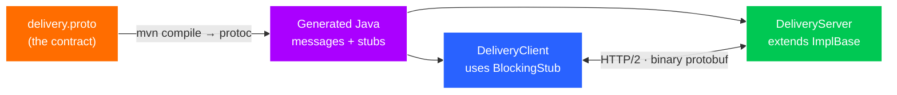

# Exercise 07 — gRPC

**Time:** ~60 min  **Port:** 9090  **Needs:** Maven  **You'll learn:** contract-first APIs with protobuf, generated stubs, unary vs streaming RPCs, gRPC status codes & deadlines

## The story
Inside QuickBite, the **Order service** asks the **Delivery service** "when will the rider arrive?" thousands of times a second. Nobody reads these calls in a browser, so we don't need human-friendly JSON. We want: small messages, a strict contract, generated client code, and streaming. That's gRPC — protobuf messages over HTTP/2.



| RPC | Shape | Real-world use |
|---|---|---|
| `GetEta` | request → response (**unary**) | a normal function call between services |
| `TrackRider` | request → **stream** of responses | live location, progress updates |
| `UploadRoute` | **stream** of requests → response | rider app uploading GPS points in bulk |
| *(bidi)* | stream ↔ stream | chat, multiplayer — not in this lab |

## Run it
```bash
mvn -q compile                     # generates code from the .proto (first run downloads protoc)
ls target/generated-sources/protobuf/java/lab/grpc     # go look at what was generated!
mvn -q exec:java                                       # terminal 1: server
mvn -q exec:java -Dexec.mainClass=lab.DeliveryClient   # terminal 2: client
```
Optional: if you have [grpcurl](https://github.com/fullstorydev/grpcurl), `grpcurl -plaintext -proto src/main/proto/delivery.proto -d '{"order_id":"ord_1"}' localhost:9090 quickbite.DeliveryService/GetEta`

## TODOs
| # | File | What |
|---|---|---|
| 1 | `DeliveryServer.getEta` | Unary: `onNext` + `onCompleted`, or `onError(NOT_FOUND)` |
| 2 | `DeliveryServer.trackRider` | Server streaming: 6 `onNext`s 500 ms apart, stop if cancelled |
| 3 | `DeliveryServer.uploadRoute` | *Stretch:* client streaming — return an observer that aggregates |
| 4 | `DeliveryClient.unary` | Call with a **deadline**, compare wire size vs JSON, handle `NOT_FOUND` |
| 5 | `DeliveryClient.streaming` | Iterate the stream; see a deadline cut it off mid-way |

## Expected client output (roughly)
```
=== 1. Unary: GetEta ===
Ravi arrives in 10 min
wire size: protobuf 15 bytes vs JSON 51 bytes
ord_999 -> NOT_FOUND: No trip for ord_999

=== 2. Server streaming: TrackRider ===
  2400 m left  (12.9352, 77.6245)
  1920 m left  (12.9356, 77.6249)
  ...
     0 m left  (12.9372, 77.6265)
  ord_2 stream ended with DEADLINE_EXCEEDED (deadline hit mid-stream)
```

## Think & answer
1. Protobuf put the reply in 15 bytes, JSON in 51. Where did the savings come from? (Field names vs field numbers, varints.)
2. You add a new field `string rider_phone = 4;` to `EtaReply`. An **old** client that doesn't know field 4 receives it. What happens? What if you *renumber* `minutes` from 2 to 5?
3. Why can't a browser call this server directly? What is **gRPC-Web** / a gateway for?
4. Why should *every* gRPC call carry a **deadline**? What happens in a chain A → B → C when C hangs and nobody set one?
5. Map these gRPC codes to the closest HTTP status: `NOT_FOUND`, `INVALID_ARGUMENT`, `UNAUTHENTICATED`, `PERMISSION_DENIED`, `UNAVAILABLE`, `DEADLINE_EXCEEDED`.
6. HTTP/2 multiplexes many calls over **one** TCP connection. Why does that make life harder for a plain L4 load balancer? (Search: gRPC load balancing, client-side LB.)
7. When would you pick gRPC over REST for service-to-service, and when would you *not*?

## Stretch
- Implement TODO 3 and run the client's section 3.
- Add a bidirectional `rpc Chat(stream ChatMessage) returns (stream ChatMessage)` and compare it with Exercise 04's WebSocket chat.
- Add a `ServerInterceptor` that logs method name + duration of every call (gRPC's version of a servlet filter).
