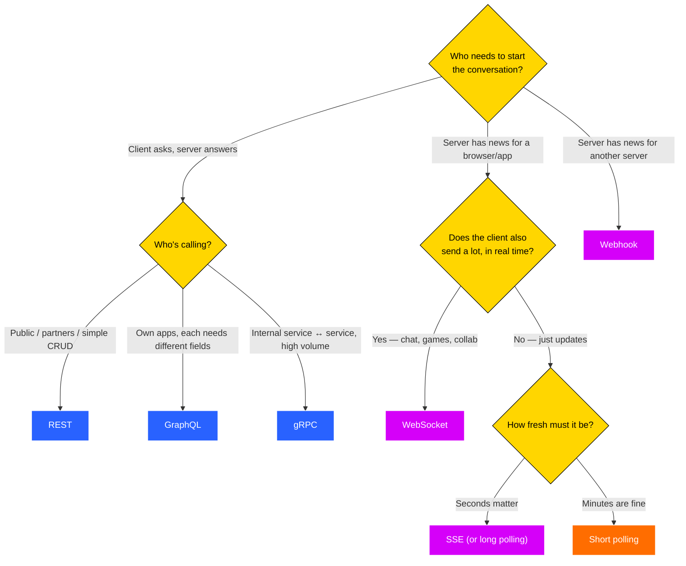

# API Design Lab — build every way two programs can talk

Eight small, hands-on exercises. One story throughout: **QuickBite**, a food-delivery app.
Each exercise takes one real problem in that app and solves it with the API style that fits it best — so by the end you don't just know *what* REST, polling, SSE, WebSockets, webhooks, GraphQL and gRPC are, you've *felt* why each one exists.

| # | Folder | Problem in QuickBite | Style | Setup | Time |
|---|---|---|---|---|---|
| 01 | `01-rest` | Place / view / list / cancel orders | **REST** | Java only | 60 min |
| 02 | `02-polling` | "Where's my order?" tracker | **Short vs long polling** | Java only | 45 min |
| 03 | `03-sse` | Same tracker, server pushes | **Server-Sent Events** | Java only | 40 min |
| 04 | `04-websockets` | Rider ⇄ customer chat | **WebSockets** (from raw sockets!) | Java only | 60 min |
| 05 | `05-webhooks` | Payment gateway tells us "paid" | **Webhooks** | Java only | 60 min |
| 06 | `06-graphql` | Home screen needs exactly these fields | **GraphQL** | Maven | 60 min |
| 07 | `07-grpc` | Order service asks delivery service for ETA | **gRPC** | Maven | 60 min |
| 08 | `08-capstone` | Which one, when? | **Design worksheet** | Pen & paper | 45 min |

## Setup
- **Java 25 or newer** (`java -version`). That's all you need for 01–05: each program is a single `.java` file you run directly with `java File.java` — no Maven, no Spring, no IDE required. We deliberately use only the JDK so nothing hides the protocol from you.
- **Maven 3.9+** for 06 and 07 (they need the GraphQL and gRPC libraries). The first build downloads dependencies, so do it once on good Wi-Fi.
- `curl` (built into macOS, Linux and Windows 10+). Windows users: run the curl examples in Git Bash, or swap `'` for `"` in PowerShell.

## How every exercise works
1. Read the folder's `README.md` — the story, a diagram, the TODO table.
2. Run the server. Every unfinished TODO replies **501 Not Implemented**, so nothing crashes.
3. Run `java Check.java` (exercises 01–05). It tells you exactly which behaviour is missing. Re-run after every TODO.
4. Answer the **Think & answer** questions. They're what interviewers actually ask.
5. Try a **Stretch** goal if you're done early.

## Ports
| 8081 | 8082 | 8083 | 8084 | 8086 | 8091 / 8092 | 9090 |
|---|---|---|---|---|---|---|
| REST | Polling | SSE | WebSocket | GraphQL | Webhooks (gateway / merchant) | gRPC |

If a port is busy: stop the earlier exercise's server (Ctrl+C).
# HLD_Assignments_Weekend
# HLD_Assignments_Weekend
